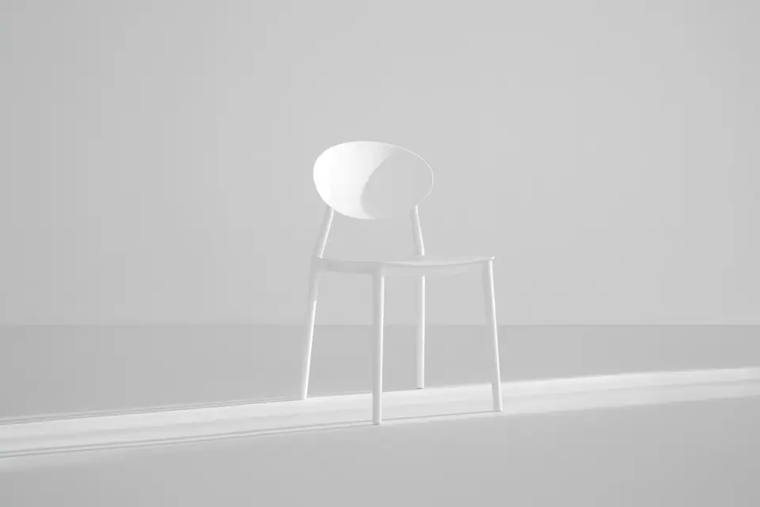
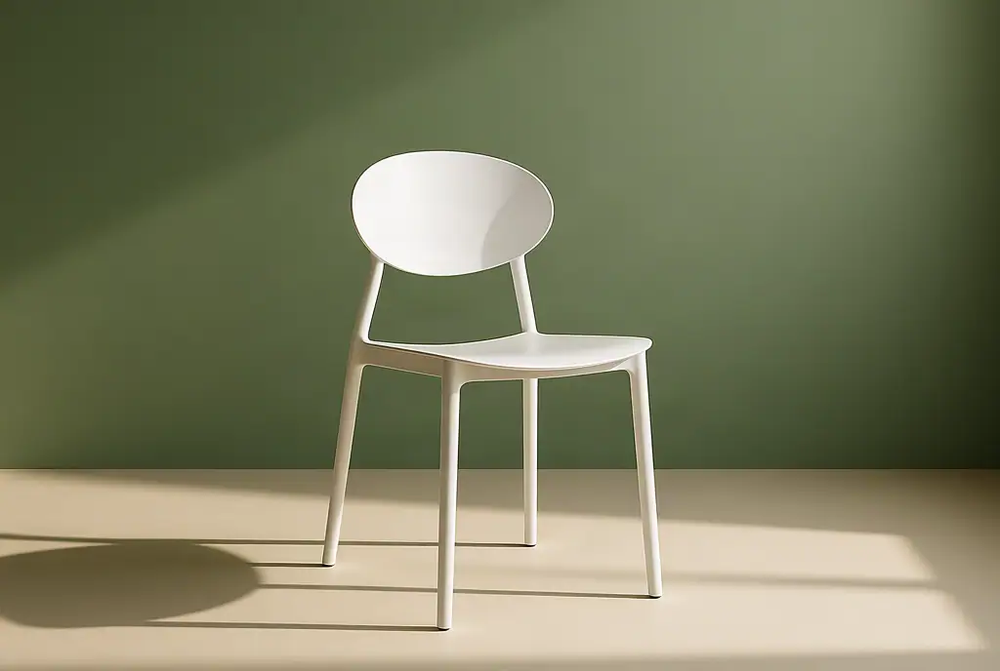

# Image-to-image prompt recipes

A practical guide to describing image edits: one change, an explicit preservation instruction, and a review checklist. Maintained by MinshengLiu, the operator of [Image to Image](https://imagetoimage.dev). This is an affiliated resource, not an independent review.

**Free interactive resource:** [Image Editing Prompt Builder](https://liubrain39.github.io/image-to-image-prompt-guide/) assembles an editing instruction from one requested change and the details to preserve. It runs in the browser without uploading a photo or calling an AI model. The six templates are starting points; only the chair example below has a documented input and actual output.

**Engineering case:** [Preparing a 48MP photo without blocking the editor](https://liubrain39.github.io/image-to-image-prompt-guide/large-image-preparation.html) documents a synthetic upload fixture, Web Worker image preparation, compatibility checks and measurement limits. The accompanying record contains no visitor images or private application code; one browser check is not a real-user performance distribution.

**Try the editor:** [Upload an image and describe one edit](https://imagetoimage.dev/#editor). Live image editing is available with prompt, input-image and output-image screening. The site also offers public guides and illustrative comparisons; those illustrations are not a generated-results benchmark. [Pricing](https://imagetoimage.dev/pricing) is US$14.99 for 100 edits, as a one-time purchase without automatic renewal; applicable taxes are shown at checkout. Check the site for current trial availability and limits.

This guide contains reusable prompt examples, not a claim that every example has been tested or that the model will preserve every detail. It is useful with image-to-image editors generally.

## Use the editor without an account

The free prompt builder above only assembles text and never uploads a photo. The linked [Image to Image editor](https://imagetoimage.dev/#editor) accepts JPG, PNG and WebP uploads and processes them on its servers. No product account is required.

- One free trial edit per day is offered, subject to service capacity and content review.
- The paid pack is **US$14.99 for 100 edits**, before applicable checkout taxes. This is a one-time purchase, with no subscription or automatic renewal.
- One request uses one edit, with output up to 1024 pixels on the longest side. A preservation prompt does not guarantee unchanged product details.
- Keep the purchase browser cookie and payment receipt. A different browser or cleared cookies may not show the balance; contact **liubrain39@gmail.com** with the receipt for missing credits or recovery. Do not send card details.

See the [product-background access and pricing FAQ](https://imagetoimage.dev/image-to-image/product-photo-background#pricing-and-access) and check [current trial availability and prices](https://imagetoimage.dev/pricing) before paying. The real example below shows both the useful change and the details the model did not preserve.

## Conversational image editing: keep one evolving brief

The linked [Image to Image editor](https://imagetoimage.dev/#editor) now offers a text assistant alongside its image workflow. This differs from the standalone free builder: the builder assembles text locally, while the assistant calls a model to refine one brief over multiple conversation turns. The assistant does not inspect image pixels and does not silently generate an image.

A three-turn brief was checked with real assistant responses on 11 October 2026:

| Follow-up | What the next brief kept or replaced |
| --- | --- |
| Use a light sage background and soft warm light; preserve the chair color and shape | Sage green, warm light, chair color and shape |
| Change the background to light blue; keep the rest | Blue replaces sage; chair and warm light remain |
| Cancel blue and return to sage green | Sage returns; chair and warm light remain |

These are verified **text-brief updates**, not three generated pictures or a claim of exact product preservation.

1. Upload a source or select a public sample, then describe what to change and what to keep.
2. Add or replace requirements in the same conversation and read the editable brief before generating.
3. After a result, choose **Original** for a fresh direction or a completed **Version** to continue from that reviewed result.
4. Generate explicitly, compare the details, and download the version you want to keep.

Chat uses no image edits; each new generated image uses one edit. The current chat and version list live only in the open tab and clear on refresh. This is not persistent project storage. Current trial availability, capacity and one-time packs are shown on the website.

See the [conversation workflow with a verified workspace screenshot](https://imagetoimage.dev/guide#conversational-editing). It includes one generated chair scene and explains both what was tested and what was not. This remains an affiliated resource maintained by the product's operator.

## One real edit: a white chair in a green studio scene

This example was generated through the public [Image to Image editor](https://imagetoimage.dev/#editor) on October 10, 2026: one request, one output, with the **Studio photo** style selected. The pictures below are the actual source and output, resized for display. This is an operator-produced example, not an independent benchmark.

| Source photograph | Actual AI output |
| --- | --- |
|  |  |

**Source photograph:** [Ellen Qin on Unsplash](https://unsplash.com/photos/white-metal-chair-bxLhqZIp2LI). The source photograph remains subject to the [Unsplash License](https://unsplash.com/license); it is not original photography by this repository's author. The output is AI-generated.

**Instruction entered:**

> Keep the white metal chair, its proportions, legs, seat and camera angle unchanged. Replace the background with a muted sage-green studio wall and a pale cream floor. Add soft daylight from the left and a natural contact shadow beneath the chair. Do not add text, logos, people or extra furniture.

**Style setting:** Studio photo. The preset additionally requests professional studio lighting, a clean neutral background, realistic detail and preservation of the main subject.

**What the result actually shows:**

- The background changed to green, the floor became cream, and the model added side lighting and a grounded shadow.
- The chair remains recognizable, but its framing, seat edge and leg details changed. The instruction did **not** preserve every product detail.
- This is useful as a scene concept. It should not be treated as a faithful catalogue photograph without checking it against the actual product.

**What to check on your own image:** compare the silhouette, proportions, material, readable labels and shadow direction separately. If the product itself must remain pixel-for-pixel identical, a conventional background cutout is a better fit than a generative replacement. Another input or another run may produce a different result.

The [interactive comparison and case notes](https://imagetoimage.dev/image-to-image/product-photo-background#real-example) show the same example on the website. The remaining recipes below are starting points, not additional verified test results.

## A three-part instruction

1. Name the change: the object, region, background or lighting that should differ.
2. Name what stays: composition, material, readable labels, proportions and unrelated objects.
3. Describe the desired finish: lighting direction, color palette, texture or medium.

Try one change per request. A long list of competing instructions can make it harder to identify why an edit failed. No prompt can guarantee pixel-perfect preservation: review the actual result before publication.

## Product photo backgrounds

> Replace the background with a pale beige studio backdrop. Keep the product shape, packaging text and logo unchanged. Add a soft grounded shadow under the product, with diffused light from the upper left.

Use an image you own or are permitted to edit. After an edit, inspect packaging text, the product silhouette, reflections and contact shadows. If any label or physical feature changes, the image may misrepresent the product and should not be used in a listing.

The [product photo background guide](https://imagetoimage.dev/image-to-image/product-photo-background) explains the input and preservation steps.

## Change one object color

> Change only the blue chair upholstery to muted terracotta. Keep the fabric texture, seams, chair frame, background and lighting unchanged.

Inspect edges where the target meets another object. Look for unwanted color spill, lost fabric detail and changes to objects that were not selected. Restating the target clearly is usually more useful than adding many vague adjectives.

## Sketch to image

> Turn this original room sketch into a daylight interior concept. Preserve the wall positions, window placement and furniture layout. Use pale oak, warm white walls and soft morning light.

Treat the result as a design concept. An image does not establish dimensions, structural feasibility, material availability or building-code compliance. Compare doorways, window heights and the arrangement against the source sketch.

## Watercolor-style landscapes

> Render this landscape as a watercolor study with soft washes, restrained blue-green tones and visible paper texture. Preserve the horizon, building positions and main shapes.

Review whether the composition remains readable at the size you plan to share. Describe medium characteristics instead of claiming that a result reproduces a particular living artist's work.

## Lighting edits

> Give the scene soft evening light from the right. Preserve the objects, their positions and surface colors. Keep the background readable and use gentle shadows rather than dramatic contrast.

Inspect shadow direction and the relative brightness of surfaces. A plausible edit needs consistent light across the scene; a bright highlight on one object with the opposite shadow direction on another is a warning sign.

## Change a background without changing the subject

> Replace the busy background with a soft light-grey studio wall. Keep the ceramic vase, its shape, glaze, orientation and position unchanged. Preserve a natural contact shadow on the table.

Check the rim, handle openings and small gaps around the subject. Generative background editing can also alter the subject: compare the silhouette against the original before publishing. For catalogue cutouts where exact edges matter, compare a dedicated background-removal workflow with a generative edit.

See the [image background editing walkthrough](https://imagetoimage.dev/image-to-image/change-image-background).

## Pencil sketch from a photo

> Convert this building photo into a graphite pencil drawing on white paper. Preserve the perspective, roofline, window count and major outlines. Use light cross-hatching and keep the sky mostly blank.

Count repeated windows and check straight lines. A sketch may look plausible while adding or removing structural details. Use it as an illustration rather than a measured architectural drawing.

## Edit a room concept

> Keep the room layout, doors, windows and furniture positions. Change the wall colour to warm off-white and the curtains to muted olive linen. Preserve the floor material and daylight direction.

Start with surface finishes before attempting structural changes. Review paths through the room and door clearances; a generated room is a visual concept, not a construction plan. See [interior design image edits](https://imagetoimage.dev/image-to-image/interior-design-edit).

## Change a short line of image text

> In my original poster, replace “Summer Market” with “Autumn Market”. Keep the existing lettering style, colour and layout. Leave the date, logo and all other text unchanged.

Read every character at full resolution after generation. If exact typography is essential, use a conventional design editor for the final lettering. Do not use text editing to forge documents, alter receipts or remove someone else's ownership mark. See [image text editing](https://imagetoimage.dev/image-to-image/image-text-editing).

## Troubleshoot an edit

| Problem | Next attempt | Review before use |
| --- | --- | --- |
| The whole scene changed | Ask for one named change and explicitly list what stays | Composition, object count and proportions |
| A label became unreadable | Ask to preserve the label; use a conventional editor if exact text is critical | Every letter, number and logo |
| Colours spread to other objects | Name the exact object and material instead of only a colour | Edges, reflections and neighbouring surfaces |
| The result looks artificial | Specify one light direction and a soft grounded shadow | Contact shadows and highlight consistency |
| The request was rejected | Remove prohibited or ambiguous requests; use a permitted source image | The service's content standards |

## Compare before downloading

- Check the requested change and every preservation constraint separately.
- Zoom in on fine text, repeated patterns, object edges and reflective surfaces.
- Keep your original file; never overwrite the only copy.
- Label concept images where someone could confuse them with a real product or event.
- Do not upload confidential material, identity documents or other sensitive personal information.

## Content restrictions

Deepfakes, face swapping, face replacement, facial reenactment and impersonation are prohibited on the linked service, including requests framed as entertainment or as consented. It also prohibits pornography/NSFW, violence/gore, hate speech, child-unsafe content/CSAM and copyright/trademark infringement. Ordinary background or lighting edits do not authorize identity changes or deceptive portrayals.

Read the [full prompting guide](https://imagetoimage.dev/guide), [content standards](https://imagetoimage.dev/terms#content-standards) and [privacy policy](https://imagetoimage.dev/privacy). No claims here imply payment-review approval, search indexing or a specific ranking.

## Contributions

Propose clearer, non-sensitive prompt examples or corrections through an issue or pull request. Do not upload private photos, personal data, API keys or forbidden content. This repository contains only this original guide; it contains no application code or licensed website template.
